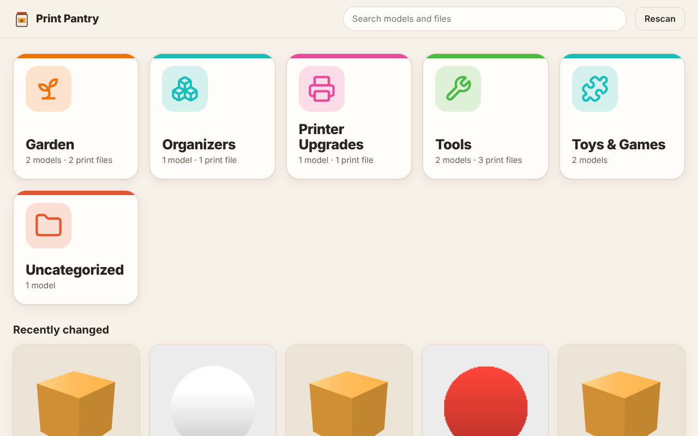
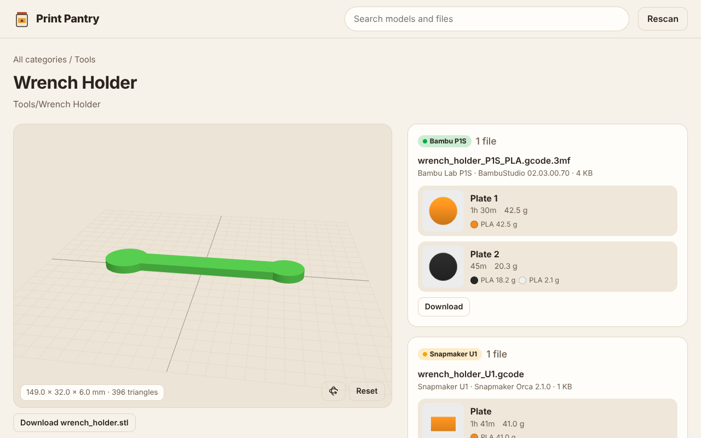

# Print Pantry

A self-hosted library for 3D printing files. Point it at a folder and it shows
big category tiles, a spinnable 3D view of each STL, and every sliced print file
grouped under the model it belongs to, with plates, print time, filament and
thumbnails.

Built for a home setup with a **Bambu Lab P1S** and a **Snapmaker U1**, running
as a container on **TrueNAS SCALE**.



## What v1 does

* Scans a library folder (read-only). One top-level folder per category, one
  folder per model inside it. Files directly inside a category folder are
  grouped into models by file name (`planter.stl`, `planter_P1S.gcode.3mf`,
  `planter_U1.gcode` become one model).
* Category tiles with icons picked from the name (Tools gets a wrench, Garden a
  sprout...). Change the icon and colour in the UI, or drop a
  `_category.json` like `{"icon": "hammer", "color": "#E4572E"}` in the folder.
* Model pages with a Three.js STL viewer (drag to spin, scroll to zoom), size in
  mm, and a switcher when a model has several STLs.
* Sliced files are detected and tagged by printer:
  * P1S `.gcode.3mf`: every plate with its thumbnail, time, weight and
    filament colours, read from `slice_info.config`.
  * U1 `.gcode` (Snapmaker Orca): thumbnail, time, per-toolhead filament.
* Project 3MFs are kept as the editable source, with **Open in Bambu Studio /
  OrcaSlicer** links.
* Search across model, category and file names. Optional password login.



## Install on TrueNAS

See [docs/truenas.md](docs/truenas.md). Short version: create
`testpool/printpantry/{library,data}`, share `library` over SMB, then install
[compose.yaml](compose.yaml) via **Apps > Install via YAML**. The UI is on port
8484.

## Configuration

| Variable | Default | Meaning |
| --- | --- | --- |
| `PP_LIBRARY` | `/library` | folder to scan |
| `PP_DATA` | `/data` | database and preview cache |
| `PP_PASSWORD` | empty | set to require a login |
| `PP_SCAN_INTERVAL` | `300` | seconds between rescans (0 = startup and button only) |
| `PP_PORT` | `8484` | HTTP port |

## Development

```sh
pip install -r requirements.txt -r requirements-dev.txt
python scripts/make_demo_library.py demo-library      # fake STLs, 3MFs, G-code
PP_LIBRARY=demo-library PP_DATA=data python -m app.main
pytest -q
```

Layout:

```
app/formats.py   3MF / G-code readers (plates, thumbnails, printer model)
app/scanner.py   folder walk, grouping into categories and models
app/config.py    env settings and printer profiles
app/store.py     SQLite: parse cache, category settings
app/main.py      FastAPI routes
app/static/      single-page UI, Three.js viewer (vendored, no build step)
```

## Roadmap

* **v2 printers**: live status (P1S over MQTT, U1 over Moonraker), camera
  snapshots, and sending a sliced file to a printer with an AMS-mapping and
  "bed is clear" check. Printer profiles in `app/config.py` already tag files
  by printer; connection details and print history will go in the same SQLite
  store.
* **v3 slicing**: a sidecar container running the OrcaSlicer CLI to turn project
  3MFs into P1S / U1 print files on the NAS.

Three.js (MIT) and Lucide icons (ISC) are vendored under `app/static/vendor`.
